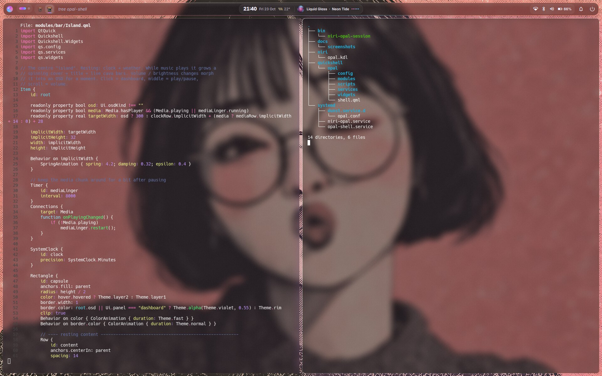
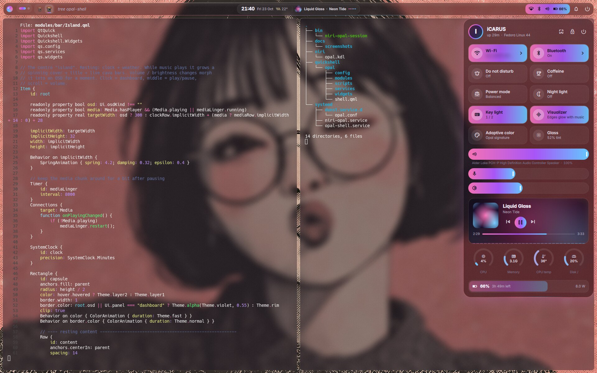
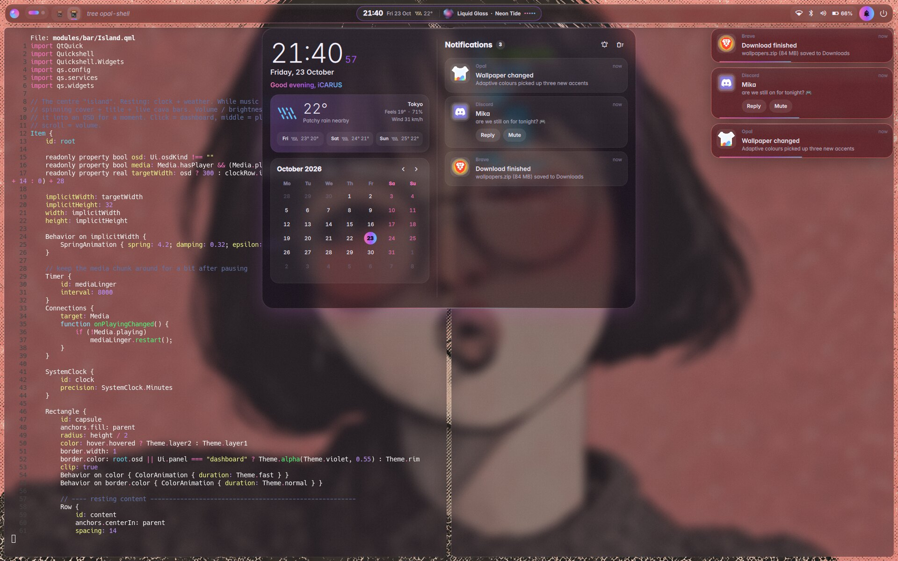
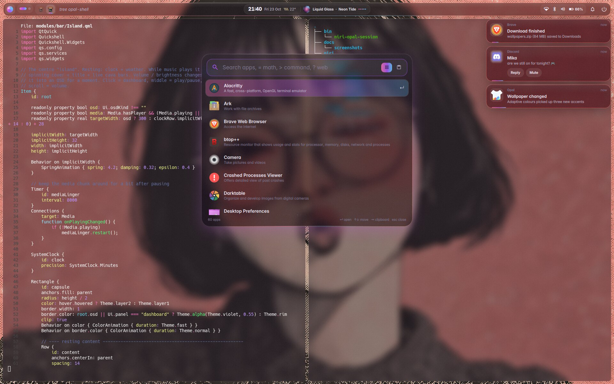
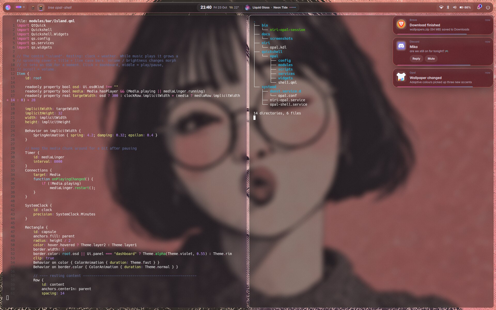
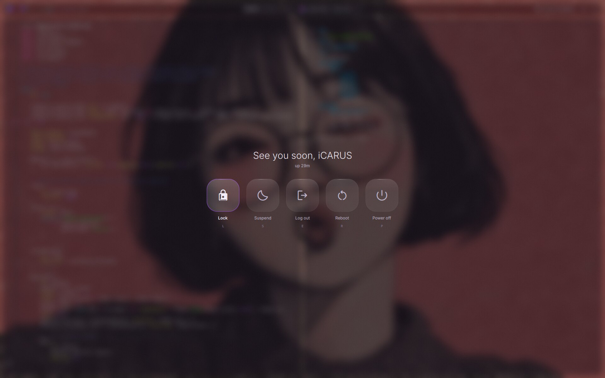
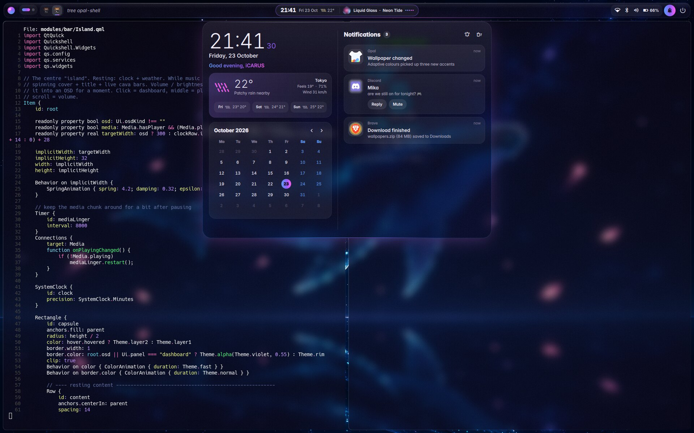
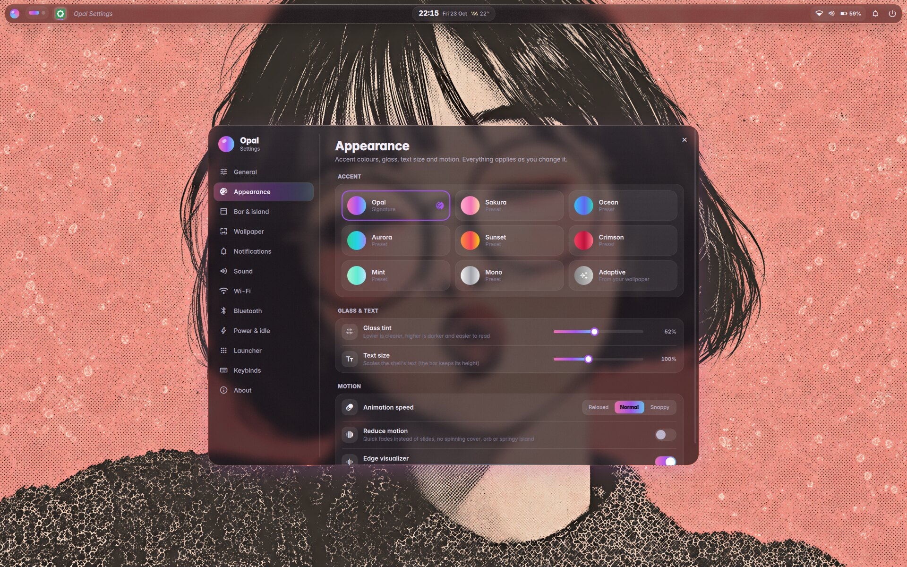
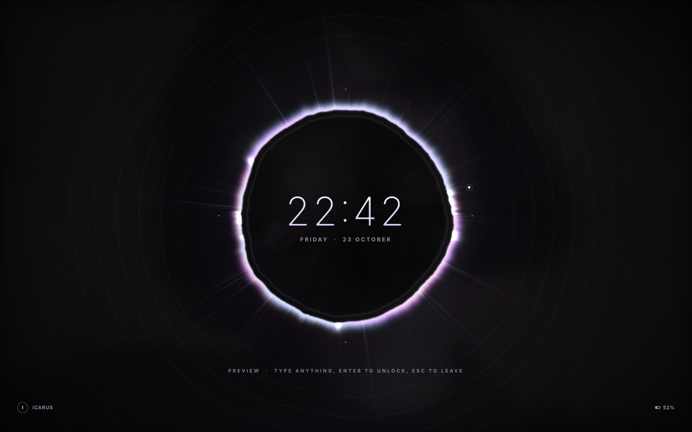

<div align="center">

# Opal

**A liquid-glass desktop shell for [niri](https://github.com/niri-wm/niri), built on [Quickshell](https://quickshell.org).**




</div>

> [!NOTE]
> **This is a vibe-coded project.** Opal was made by describing what I wanted
> to an AI coding agent ([Claude Code](https://claude.com/claude-code)), which
> wrote the QML, ran it in a nested niri session, screenshotted the result and
> iterated. It was tested by running it, not audited line by line, so expect
> rough edges. Issues and pull requests are welcome.

Every glass pane in Opal is its own layer surface, so niri's real background
blur, rounded corners and glow line up exactly with what's drawn. It runs as a
separate **"Niri (Opal)"** login session next to your normal niri session.

## Features

| | |
|---|---|
| **Bar** | Floating glass bar with niri workspace dots and a **window strip**: one icon per window in your scrolling-column order. Click to focus, middle-click to close, scroll to move along the columns. |
| **Island** | The centre capsule shows the clock and weather. While music plays it grows a spinning cover, the track and live cava bars. Volume and brightness changes briefly morph it into an OSD. |
| **Control centre** | Wi-Fi (network list and password prompt), Bluetooth devices, do not disturb, caffeine, power profile, night light, keyboard backlight. Volume, mic and brightness sliders, a now-playing card, CPU/RAM/temperature/disk gauges, battery. |
| **Dashboard** | Big clock, greeting, weather with a 3-day forecast, calendar, notification history. |
| **Launcher** | Apps ranked by match and by how often you open them. `=2^10/3` calculates (Enter copies), `>cmd` runs a command, `?words` searches the web, `Tab` switches to clipboard history. |
| **Notifications** | Opal is the session's notification daemon: glass toasts with action buttons, a countdown that pauses on hover, critical alerts, do not disturb. |
| **Wallpapers** | Thumbnail picker for your wallpaper folder, cross-fade transitions, shuffle. The wallpaper also stays behind niri's overview. |
| **Edge visualizer** | Music-reactive bars along the screen edges, under your windows. Click-through, and gone after a second of silence. |
| **Power menu** | Full-screen frosted menu. Log out, reboot and power off give you a 3-second countdown. |
| **Lock screen** | `Super+Esc`. A GPU-shaded "eclipse": a black glass lens with a razor-thin pearl rim and coronal filaments that stir as you type. Each keystroke writes a procedurally generated alien glyph (random per lock, never derived from what you type). Enter pulls the glyphs into the ring; a wrong password makes the rim shudder and sends out a shockwave; the right one dissolves it into your wallpaper. Uses `ext-session-lock` + PAM, re-locks itself if the shell crashes, and falls back to hyprlock if the shell isn't running. Preview it from Settings → Power & idle. |
| **Adaptive colour** | Optionally takes the accent colours from the wallpaper instead of the pink → violet → cyan signature palette. |
| **Settings app** | `Super+I`: a floating glass window with 12 pages. Pick from 8 accent presets or adaptive colour, set glass tint, text size, animation speed or reduce motion, choose what the bar and island show, set up wallpaper fit, transitions and a slideshow, notification timing, audio devices, Wi-Fi, Bluetooth, idle lock / screen-off / suspend, scheduled night light, low-battery warning and the search engine. Includes a keybind cheat sheet. Changes apply live. |

<table>
  <tr>
    <td></td>
    <td></td>
  </tr>
  <tr>
    <td></td>
    <td></td>
  </tr>
  <tr>
    <td></td>
    <td></td>
  </tr>
  <tr>
    <td></td>
    <td></td>
  </tr>
</table>

## Requirements

- **niri 26.04+** (layer-surface blur arrived in 26.04)
- **Quickshell 0.2**: in Fedora's repos as `quickshell`
- Runtime tools: `cava`, `cliphist`, `wl-clipboard`, `wlsunset`, `brightnessctl`,
  `playerctl`, `ImageMagick`, `curl`
- Services: PipeWire, NetworkManager, BlueZ, UPower
- From the bundled niri config: `kitty`, `hyprlock`, `swayidle`, `xfce-polkit`
  (swap in your own; see [Notes](#notes))
- Optional: the [Fluent](https://github.com/vinceliuice/Fluent-icon-theme) icon theme
  (`Fluent-purple-dark`). Without it, Quickshell falls back to hicolor icons.

Developed on Fedora 44 with the `ly` display manager. Any display manager that
reads `/usr/share/wayland-sessions` should work.

## Install

```sh
git clone https://github.com/perfc-dll/opal-shell.git ~/projects/opal-shell
cd ~/projects/opal-shell
./install.sh
```

The installer:

1. **Symlinks** the dotfiles into place, so later edits in the repo are live.
   Anything already there is moved to `~/.cache/opal/backup-<date>/`.
2. Downloads the **Inter** and **Material Symbols Rounded** fonts to `~/.local/share/fonts/opal`.
3. Asks before running the **sudo** part: packages (dnf, or pacman) and the
   `/usr/share/wayland-sessions/niri-opal.desktop` login entry.

Then log out and pick **Niri (Opal)** on your login screen. Your regular niri
session and `~/.config/niri/config.kdl` are not touched.

## Keys

| Key | Action |
|---|---|
| `Super+D` / `Super+Space` | Launcher |
| `Super+V` | Clipboard history |
| `Super+A` | Control centre |
| `Super+N` | Dashboard / notifications |
| `Super+I` | Settings |
| `Super+W` / `Super+Shift+W` | Wallpaper picker / random wallpaper |
| `Super+Shift+B` | Show / hide the bar |
| `Super+Shift+E` | Power menu (`Super+Ctrl+Shift+E` = niri's own quit) |
| `Super+Esc` | Lock (`Super+Ctrl+Esc` = hyprlock fallback) |
| `Super+O` | niri overview |
| `Super+Ctrl+R` | Restart the shell |
| `Super+Shift+/` | niri hotkey overlay (Opal's binds are labelled) |

## Settings

Open the settings app with `Super+I`, the gear in the control centre, or by
typing "settings" in the launcher. Everything is stored in
`~/.local/state/opal/settings.json` (or `$OPAL_STATE_DIR/settings.json`), and
hand edits apply live too. *About → Reset to defaults* puts everything back
except your wallpaper, name and app ranking.

Everything can also be driven from the command line, and the niri binds use these commands:

```sh
qs -c opal ipc show                          # list every target and function
qs -c opal ipc call shell toggle control
qs -c opal ipc call wallpaper set ~/Pictures/wallpapers/foo.png
journalctl --user -u opal-shell -f           # logs
```

## Repository layout

```
quickshell/opal/      the shell (QML): shell.qml, config/, services/, widgets/, modules/
niri/opal.kdl         niri config used only by the Opal session
systemd/              niri-opal.service, opal-shell.service, dunst drop-in
bin/                  niri-opal-session (what the login screen runs)
extras/               optional bits (power-profile helper)
docs/screenshots/
```

## Notes

- **`niri/opal.kdl` is a personal niri config** (window rules, GLSL open/close
  shaders, app binds) plus the Opal parts: the `opal-*` layer rules, the startup
  lines and the binds titled "Opal:". Change the output, apps and cursor theme to suit your machine.
- **dunst** has a systemd drop-in that keeps it from starting only while the
  Opal session runs, because Opal owns `org.freedesktop.Notifications` there.
- **Power mode tile:** needs a small root helper; see [extras/power-profile](extras/power-profile).
- **Default session with ly on SELinux systems:** ly may be blocked from saving
  your last session (`AVC denied ... save.txt`). Writing `0` and `youruser:999`
  as two lines into `/etc/ly/save.txt` preselects the last session in ly's list.
- **Lock screen safety:** only a PAM success unlocks; there is no IPC to unlock.
  It authenticates with its own `quickshell/opal/pam/password` (pam_unix only), so an
  enrolled fingerprint can't stall the password prompt. While locked, a flag in
  `$XDG_RUNTIME_DIR` lets a restarted shell take the lock back over. If you
  ever get stuck on a locked screen with no prompt, switch to a TTY
  (Ctrl+Alt+F3), log in, and run `systemctl --user restart opal-shell`.
- **Shaders:** after editing `quickshell/opal/shaders/*.frag`, run
  `quickshell/opal/scripts/build-shaders.sh` (needs `qsb`, part of qt6-qtshadertools)
  and restart the shell.
- Wallpapers in the screenshots aren't part of this repo.

## Uninstall

```sh
./uninstall.sh                 # removes the symlinks that point into this repo
sudo ./uninstall.sh --system   # removes the login entry
```

## Credits

[Quickshell](https://quickshell.org) · [niri](https://github.com/niri-wm/niri) ·
[cava](https://github.com/karlstav/cava) · [Material Symbols](https://fonts.google.com/icons) (Apache 2.0) ·
[Inter](https://rsms.me/inter/) (OFL) · [wttr.in](https://wttr.in)

## License

[MIT](LICENSE)
